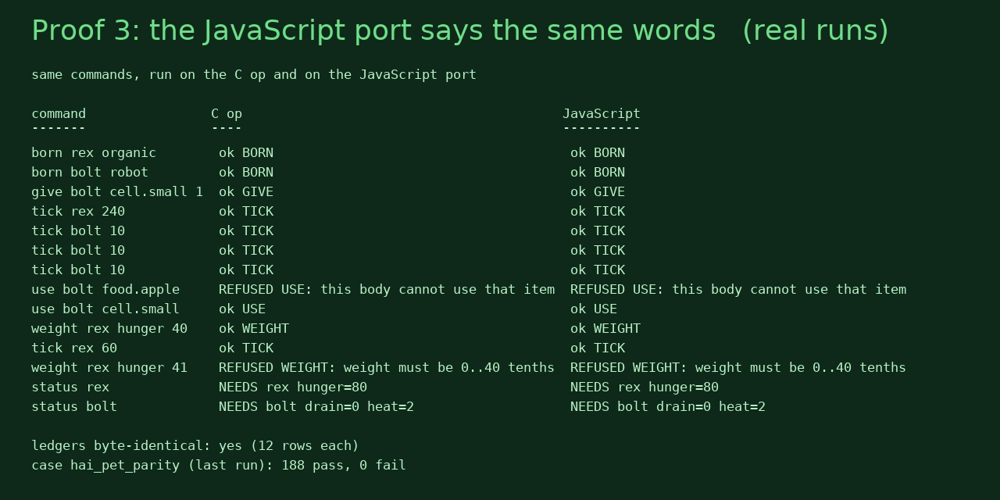

# hai (harnecient-hai)

A small, private, source-available chat terminal. It opens from a `hai` command, makes a local account instantly, and chats through a finite state machine with human-readable weights. No language model. You can grade replies (0 to 4) and link documents that the bot learns from at once.

Status: **runs, and learns what you teach it.** It asks about words it does not know, remembers your answers, shows why it answered (the WHY line), and has a dashboard. See `book/` (HAI-IQ-BOOK), start with `book/24-how-hai-answers-the-transparent-pipeline-2026-11-23.md`.

- Try it in a browser (no install): https://jbro885wgu.github.io/harnecient-hai/
- Install (Linux or macOS, needs a C compiler, no sudo): `curl -fsSL https://raw.githubusercontent.com/jbro885wgu/harnecient-hai/hai/install.sh | sh -s -- hai`, then type `hai`. Your chat ledger stays in `~/.local/share/hai-chat`; `sh install.sh uninstall` removes the program.
- Teach it: `/teach word = meaning`, `/alias word = concept`, `/say word = text`, `/mark word`, `/pack lyfedesk`, `/grade 0` to `/grade 4`; see `/bank` (what it knows) and `/why` (why it answered).
- Licence: pending the owner's choice (source-available, read and run for non-commercial use). See `LICENSE` once added.
- Docs: `book/00-INDEX.md`.

## The pet (proof of concept, 2026-11-23)

**Textbook:** [`docs/textbook.html`](docs/textbook.html) ([markdown](docs/textbook.md)): how to use hai-pal, how it works, the test evidence, the house integration map and the roadmap.

**Try it in your browser: [`docs/pet.html`](docs/pet.html)** (on the site: `/pet.html`). Walk the pet around a small room with the arrows, give it food, let time pass, turn a need off, switch the body (organic, robot, cyborg), change who the master is, and download your save. Everything runs in your browser from the same rules and data files the C programs read (`docs/world.rules.pdl`, `docs/pet-data/`); the C and JavaScript sides are checked against each other on thousands of random steps (case `hai_compat`).


A pet whose **body is data**: an organic body, a robot body or a cyborg, each one small file (`docs/pet-data/body_*.pdl`) that says which needs rise, how fast, and which items satisfy them. The same code runs every body; a weight (0 to 40 tenths) speeds a need up, slows it down, or switches it off. Everything the pet is comes from rows in one ledger, so replaying the rows gives exactly the same pet. Every slide above is a real run, not a mock-up.

| What | Where | Checked by |
|---|---|---|
| the needs core in C | `ops/hai_pet.c`, data in `docs/pet-data/` | case `cases/hai_pet.pdl`: 34 checks, and the tick arithmetic is compared with the house needs op on the same minutes |
| the JavaScript port | `docs/pet.js` (also a command line) | case `cases/hai_pet_parity.pdl`: 188 checks, same words and exit codes, byte-identical ledgers, each side replays the other's ledger |
| the design | `book/25-...` (embodied agents) and `book/26-...` (needs, food, farming, bodies, cyborgs) | design only, labelled as such |

Try it (needs a C compiler, or node):

```sh
cc -std=gnu11 -O2 -o hai_pet ops/hai_pet.c
./hai_pet docs/pet-data /tmp/pet.ledger born rex organic
./hai_pet docs/pet-data /tmp/pet.ledger give rex food.apple 2
./hai_pet docs/pet-data /tmp/pet.ledger tick rex 240      # four hours pass
./hai_pet docs/pet-data /tmp/pet.ledger status rex        # NEEDS rex hunger=40
node docs/pet.js docs/pet-data /tmp/pet2.ledger born bolt robot    # the same verbs in JavaScript
```

Every check can fail: breaking either implementation on purpose (dropping the carried remainder, changing a limit, changing a clamp) turns the cases red, and that was run. **Not done yet:** the pet on the web page, a world to walk in, planting and cooking, anatomy parts, evolving a body. Those are in the design chapters, not in code.

<details><summary>Stills</summary>




</details>
