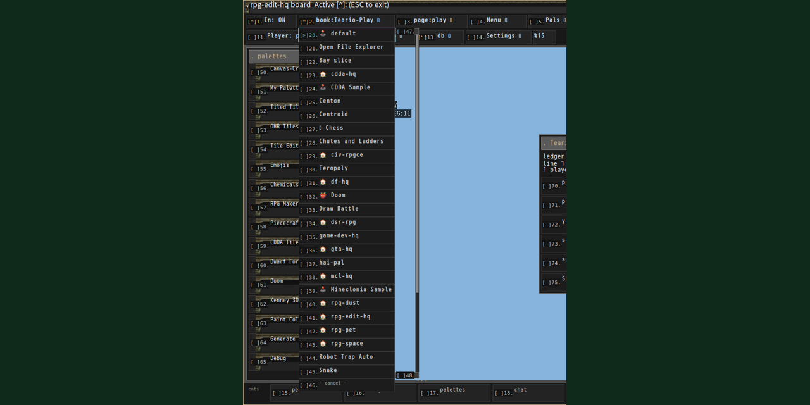
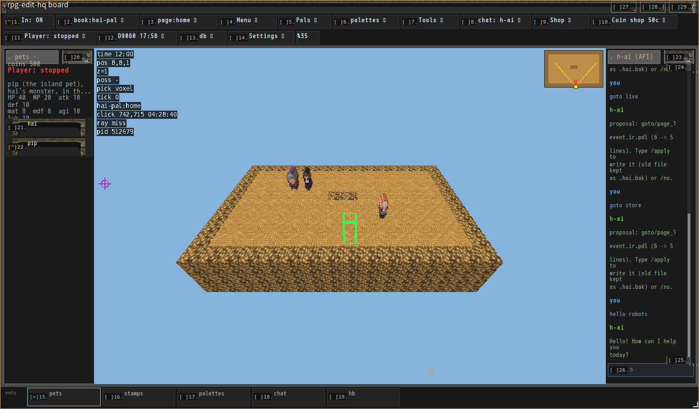
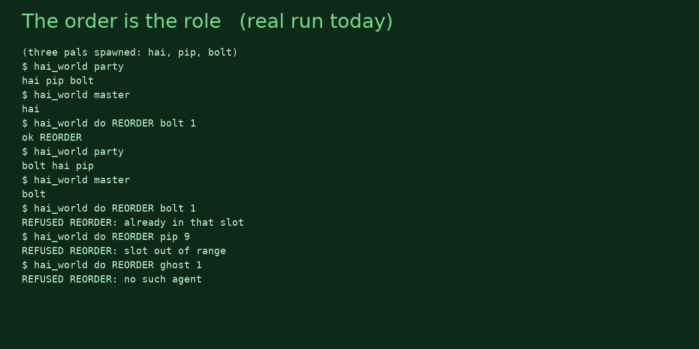
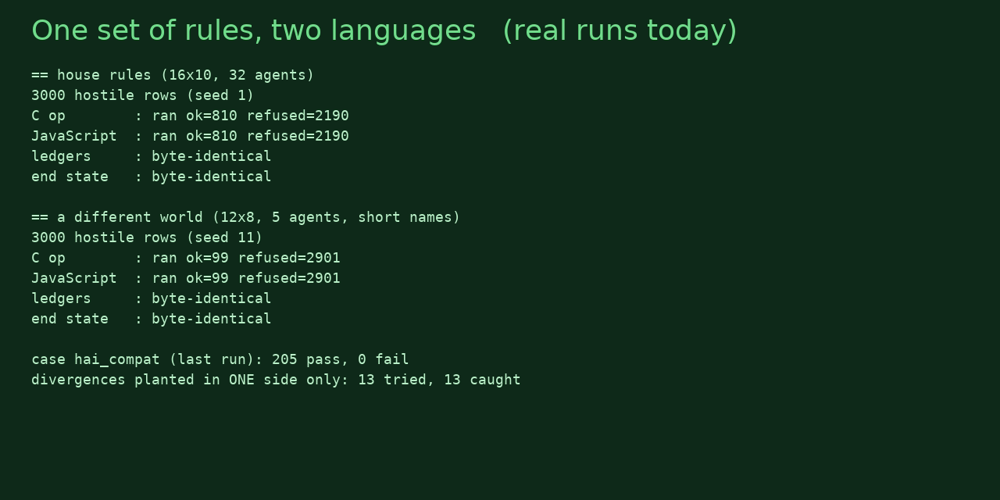
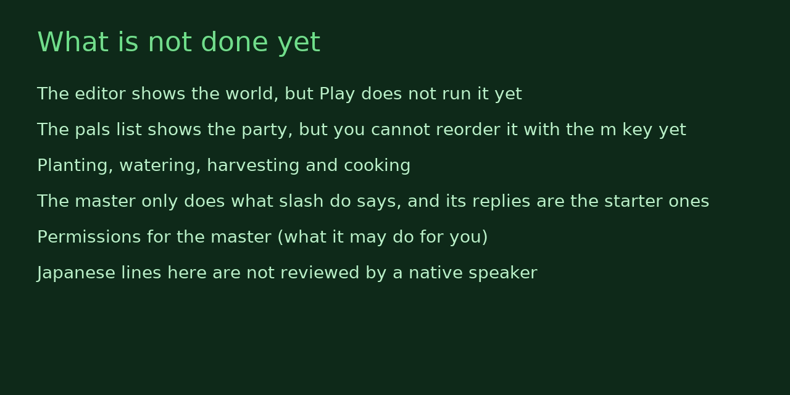
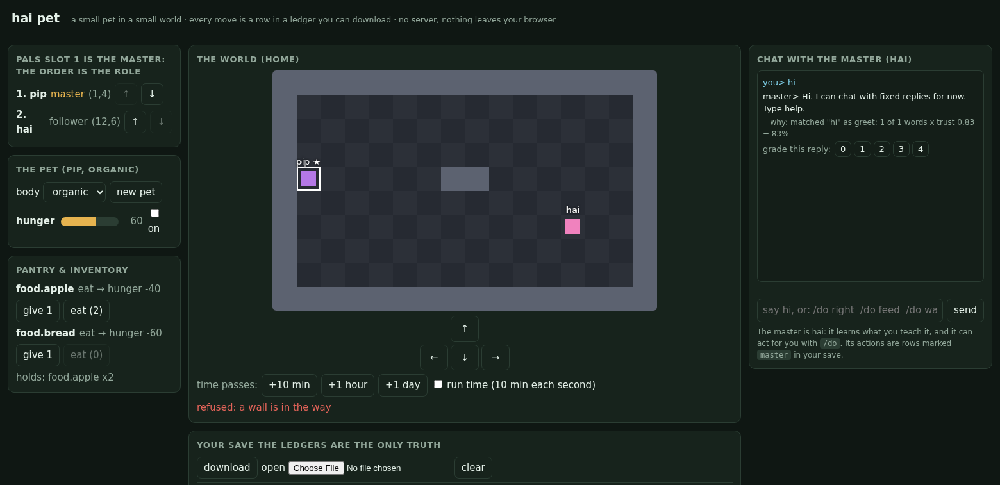
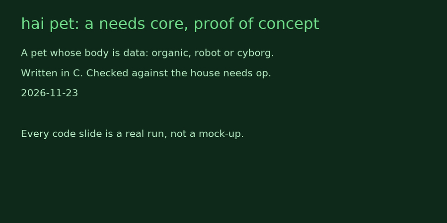
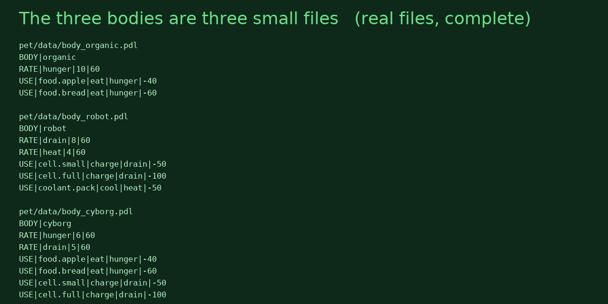
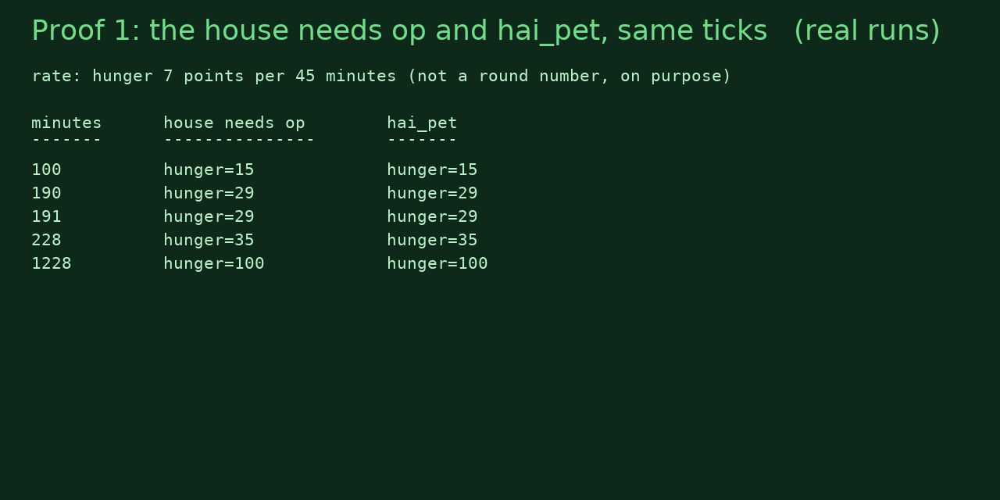
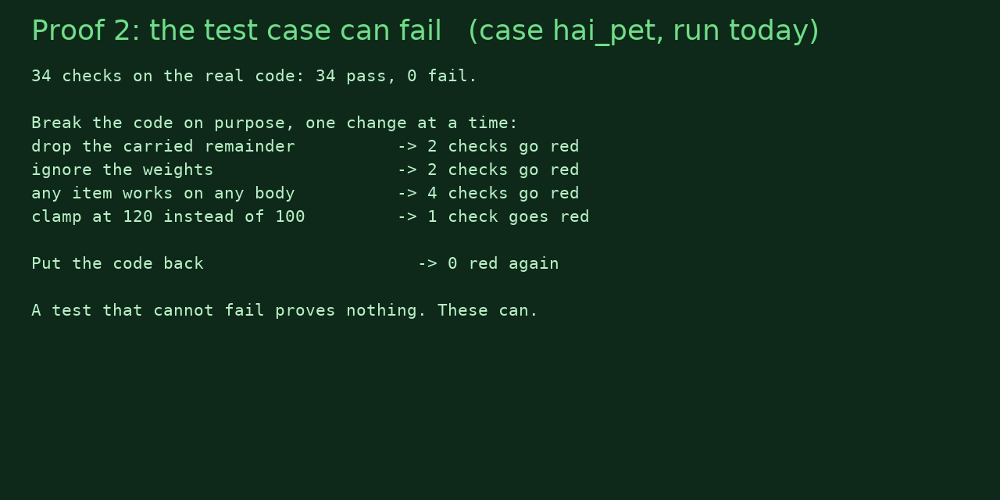

# hai (harnecient-hai)

**Live:** [Try hai in your browser](https://jbro885wgu.github.io/harnecient-hai/) · [The pet page](https://jbro885wgu.github.io/harnecient-hai/pet.html) · [The textbook](https://jbro885wgu.github.io/harnecient-hai/textbook.html)

A small, private, source-available chat terminal. It opens from a `hai` command, makes a local account instantly, and chats through a finite state machine with human-readable weights. No language model. You can grade replies (0 to 4) and link documents that the bot learns from at once.

Status: **runs, and learns what you teach it.** It asks about words it does not know, remembers your answers, shows why it answered (the WHY line), and has a dashboard. See `book/` (HAI-IQ-BOOK), start with `book/24-how-hai-answers-the-transparent-pipeline-2026-11-23.md`.

- Try it in a browser (no install): https://jbro885wgu.github.io/harnecient-hai/
- Install (Linux or macOS, needs a C compiler, no sudo): `curl -fsSL https://raw.githubusercontent.com/jbro885wgu/harnecient-hai/hai/install.sh | sh -s -- hai`, then type `hai`. Your chat ledger stays in `~/.local/share/hai-chat`; `sh install.sh uninstall` removes the program.
- Teach it: `/teach word = meaning`, `/alias word = concept`, `/say word = text`, `/mark word`, `/pack lyfedesk`, `/grade 0` to `/grade 4`; see `/bank` (what it knows) and `/why` (why it answered).
- Licence: pending the owner's choice (source-available, read and run for non-commercial use). See `LICENSE` once added.
- Docs: `book/00-INDEX.md`.

## hai-pal: a world, a party and a pet (2026-11-24)

hai-pal puts hai in a small world. **Pals** (small agents) live on **pages** (rooms), walk, hold items and have needs. They are led by a **master**. Three ideas carry everything:

1. **One ledger is the truth.** Every event is a row in an append-only text file (`SPAWN|pip|home|5|3`, `MOVE|pip|1|0`, `TICK|pip|540`). The room, the hunger bars and the order of the pals are derived by replaying the rows. A request the rules refuse is kept as a `REFUSED` row, so nothing is hidden.
2. **The order is the role.** The party is an ordered list. **Whoever is first is the master**; the rest follow. Move another pal to the front and it becomes the master.
3. **Bodies are data.** A pet is organic, robot or cyborg because of a small file of needs and items, not because of code.

**Try it now:** [the pet page](https://jbro885wgu.github.io/harnecient-hai/pet.html) (walk, feed, let time pass, turn needs off, chat with the master, save and reopen) and [the textbook](https://jbro885wgu.github.io/harnecient-hai/textbook.html) (how to use everything, the evidence, the roadmap).

### In the LyfeDesk editor (rpg-edit)

hai-pal opens as a book. It appears in the Books list, draws its rooms, and the pets bar on the left lists the party the book ships: **hai** (the master) then **pip**.





### The order is the role (a real run)



### One set of rules, two languages

The same rules run in C and in JavaScript, read their numbers from one data file (`docs/world.rules.pdl`), and are checked against each other: 3000 hostile random commands per run, and the ledgers and end states must be **byte-identical**.



| Case | Checks | Proves |
|---|---|---|
| `hai_world`, `hai_world_parity`, `hai_world_reorder` | 62, 213, 134 | the rules, and C = JavaScript |
| `hai_compat` | 205 | the differential test, two different worlds, every refusal reached |
| `hai_pet`, `hai_pet_parity` | 34, 188 | the needs rules, checked against the house needs program |

836 checks pass, and 13 deliberate one-sided breakages each turned the differential test red.

### What is not done yet



**Roadmap (full list in the textbook, Part 8):** (A) the `m` move mode with the arrow keys, and the party file written from the ledger; (B) event rows with hash checkpoints, the Play driver, one session through two doors; (C) permissions for the master, interface verbs, plain-language requests, pals talking to each other; (D) farming and cooking, anatomy and bodies, real-folder bodies, shared data, texting; (E) one shared implementation of the rules for C and the web.

**Run the tests:** `harness_case_op.+x <case>.pdl <house>` from `cases/` (the LyfeDesk house harness), then compare the number of `EXPECT_` rows with the `PASS` lines in `results/<case>.txt`.

## The pet (proof of concept, 2026-11-23)

**Textbook:** [`docs/textbook.html`](docs/textbook.html) ([markdown](docs/textbook.md)): how to use hai-pal, how it works, the test evidence, the house integration map and the roadmap.

**Try it in your browser: [`docs/pet.html`](docs/pet.html)** (on the site: `/pet.html`). Walk the pet around a small room with the arrows, give it food, let time pass, turn a need off, switch the body (organic, robot, cyborg), change who the master is, and download your save. Everything runs in your browser from the same rules and data files the C programs read (`docs/world.rules.pdl`, `docs/pet-data/`); the C and JavaScript sides are checked against each other on thousands of random steps (case `hai_compat`).





A pet whose **body is data**: an organic body, a robot body or a cyborg, each one small file (`docs/pet-data/body_*.pdl`) that says which needs rise, how fast, and which items satisfy them. The same code runs every body; a weight (0 to 40 tenths) speeds a need up, slows it down, or switches it off. Everything the pet is comes from rows in one ledger, so replaying the rows gives exactly the same pet. Every slide above is a real run, not a mock-up.

| What | Where | Checked by |
|---|---|---|
| the needs core in C | `ops/hai_pet.c`, data in `docs/pet-data/` | case `cases/hai_pet.pdl`: 34 checks, and the tick arithmetic is compared with the house needs op on the same minutes |
| the JavaScript port | `docs/pet.js` (also a command line) | case `cases/hai_pet_parity.pdl`: 188 checks, same words and exit codes, byte-identical ledgers, each side replays the other's ledger |
| the design | `book/25-...` (embodied agents) and `book/26-...` (needs, food, farming, bodies, cyborgs) | design only, labelled as such |

Try it (needs a C compiler, or node):

```sh
cc -std=gnu11 -O2 -o hai_pet ops/hai_pet.c
./hai_pet docs/pet-data /tmp/pet.ledger born rex organic
./hai_pet docs/pet-data /tmp/pet.ledger give rex food.apple 2
./hai_pet docs/pet-data /tmp/pet.ledger tick rex 240      # four hours pass
./hai_pet docs/pet-data /tmp/pet.ledger status rex        # NEEDS rex hunger=40
node docs/pet.js docs/pet-data /tmp/pet2.ledger born bolt robot    # the same verbs in JavaScript
```

Every check can fail: breaking either implementation on purpose (dropping the carried remainder, changing a limit, changing a clamp) turns the cases red, and that was run. **Not done yet:** the pet on the web page, a world to walk in, planting and cooking, anatomy parts, evolving a body. Those are in the design chapters, not in code.

<details><summary>Stills</summary>






</details>
